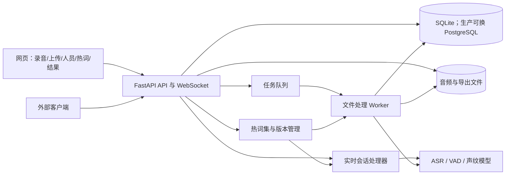
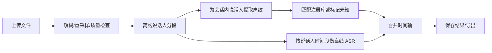

# ASR 与说话人识别平台：详细设计与实施计划

版本：0.2（2026-10-23）  
状态：实施基线，模型阈值与性能指标待真实录音校准

## 1. 目标与边界

建设一个可本地部署、可通过网页和 API 使用的平台，提供：

1. 实时语音转文字：浏览器录音或客户端通过 WebSocket 发送音频，收到临时文字与最终文字。
2. 文件语音转文字：上传音频，异步处理并输出带起止时间的文本。
3. 声纹注册：为人员上传多段单人语音，生成并保存声纹，支持查看、补充样本、删除和重新注册。
4. 说话人分段：区分一段录音中不同人的发言；对于已注册人员输出姓名，未匹配者输出稳定的“未知说话人 1/2”等会话内编号。
5. 结果查看与导出：时间轴、音频回放、文本、说话人筛选，以及 JSON/TXT/SRT 导出。
6. 热词管理：在网页上新增、编辑、停用和删除热词集；实时会话和文件任务都可选用热词集。
7. 容量验证：提供可重复运行的并发压力测试与资源报告，明确目标机器能稳定处理的实时路数和文件任务数。
8. 演示网页：可从注册声纹开始，完成录音、上传、热词对比、说话人结果展示的完整操作。

首版重点是普通话为主、兼顾英语的会议/访谈录音。首版不承诺精准分离多人同时讲话，也不把声纹识别作为身份认证手段。TTS 不在本需求范围内。

## 2. 参考项目与技术取舍

| 内容 | 参考与取舍 |
| --- | --- |
| API 形式 | 参考 [voiceapi](https://github.com/ruzhila/voiceapi) 的 FastAPI、WebSocket `/asr` 与文件 `/asr_file`。独立实现会话状态、持久化和任务系统。 |
| ASR 引擎 | 使用 [sherpa-onnx](https://github.com/k2-fsa/sherpa-onnx)：在线模型负责低延迟临时文字，离线模型负责文件和实时片段的最终文字。启用热词时选择支持 Transducer `modified_beam_search` 的识别路径。 |
| 热词能力 | [在线 Transducer](https://github.com/k2-fsa/sherpa-onnx/blob/master/sherpa-onnx/python/sherpa_onnx/online_recognizer.py) 和 [离线 Transducer](https://github.com/k2-fsa/sherpa-onnx/blob/master/sherpa-onnx/python/sherpa_onnx/offline_recognizer.py) 支持热词加权；SenseVoice 的 `from_sense_voice` 接口没有同等原生热词参数，因此不能用文本替换冒充识别热词。 |
| 声纹 | 使用 `SpeakerEmbeddingExtractor` 提取向量，并按 [官方注册/检索示例](https://github.com/k2-fsa/sherpa-onnx/blob/master/python-api-examples/speaker-identification-with-vad.py) 匹配已注册人员。 |
| 文件说话人分段 | 使用 `OfflineSpeakerDiarization`，参考 [官方 Python 示例](https://github.com/k2-fsa/sherpa-onnx/blob/master/python-api-examples/offline-speaker-diarization.py)。其输出是时间范围和临时 speaker 编号；姓名匹配需要额外做声纹比对。 |
| 实时说话人分段 | 基于 VAD、滑动声纹窗口和说话人变化检测实现增量分段；会在片段结束后确认。离线分段模型不直接当成真正的实时模型。 |
| 项目复用 | `voiceapi` 当前没有完整的注册、持久化与按人分段功能；其全局 VAD 状态不适合直接承担多会话并发。参考接口思想，平台代码独立组织。 |

初始模型候选：流式 Zipformer 中英模型、支持热词的离线 Transducer 模型、SenseVoice（作为无原生热词的可选质量对照）、Silero VAD、`3dspeaker_speech_eres2net_base_sv_zh-cn_3dspeaker_16k.onnx` 声纹模型、`sherpa-onnx-pyannote-segmentation-3-0` 分段模型。默认交付组合必须让流式和文件识别都能启用热词，具体离线模型在 P0 用业务样本确认。模型版本和实际许可证在集成时逐个固定、记录；发布前核对模型文件自带许可证。模型来源见 [sherpa-onnx 分段模型文档](https://github.com/k2-fsa/sherpa/blob/master/docs/source/onnx/speaker-diarization/models.rst)。

## 3. 系统结构



首版采用“模块化单体 + 独立文件处理进程”。API 进程负责连接、鉴权和结果查询；文件处理进程负责长任务，避免模型推理堵塞 WebSocket 事件循环。模型在每个推理进程启动时加载一次；识别器可共享，但每个连接的 stream、VAD、音频缓冲与说话人状态必须独立。控制并发数并设置有界队列，达到上限时明确返回忙碌错误。

建议目录：

```text
backend/app/
  api/             HTTP、WebSocket 路由与请求校验
  audio/           解码、声道处理、重采样、时间戳
  engines/         sherpa-onnx 模型适配层
  speakers/        注册、向量存取、检索、分段映射
  hotwords/        热词集、版本、模型分词编译与校验
  pipelines/       file_pipeline、live_pipeline
  jobs/            任务状态与 Worker
  storage/         数据库、文件、迁移
frontend/          网页控制台
models/            下载脚本与校验清单；模型本体不入库
tests/             样例音频、接口与端到端测试
```

## 4. 音频输入规范

- 内部统一为 16 kHz、单声道、Float32 音频；保留原始采样率、声道和时间信息。
- 实时 API 首版接收 PCM s16le、16 kHz、单声道。浏览器负责重采样，服务端再次校验数据长度、速率和协议版本。后续可增加 Opus。
- 文件 API 接受 WAV、MP3、M4A、OGG/Opus；用 FFmpeg 解码并统一重采样。限制文件大小、时长和并发，具体上限作为部署配置。
- 双声道文件默认合成单声道以做通用分段；若左右声道本来是独立话筒，提供 `channel_mode=separate`，按声道分别处理并保留声道号。
- 时间戳统一基于**原音频起点**，单位秒。重采样、裁剪与窗口重叠不能改变这一基准。
- 保存原文件与标准化音频的校验值；临时 PCM 处理后及时清理。

## 5. 声纹注册与识别

### 5.1 注册流程

1. 创建人员记录，获得稳定的 `speaker_id`；姓名可以修改，ID 不变。
2. 上传多段仅有该人说话的样本。推荐 3 段以上、每段约 5–15 秒，覆盖正常说话而非同一句重复录制；这些是采集建议，不是模型硬性要求。
3. 对每段执行解码、重采样、VAD、过短/静音/削波等质量检查。混入第二人、严重噪声或有效语音不足的样本拒绝并说明原因。
4. 对每段有效语音提取 embedding，L2 归一化；保存每段向量、质量指标、模型版本和聚合后的人员向量。聚合先用归一化均值，后续可按质量加权。
5. 用本地验证集校准相似度阈值和“第一名与第二名差距”阈值；低于阈值时输出 `unknown`，不强行认人。

注册使用的 embedding 模型与识别使用的模型必须相同。升级模型后，所有已注册声纹需从保留的样本重算；如果只保留向量，则需要人员重新上传样本。

### 5.2 文件中的人员映射

先由离线分段模型得到会话内 `speaker_0/1/...` 及其时间范围。对每个临时说话人挑选多个较长、非重叠的干净片段提取 embedding，形成该人的会话向量，再与注册库比较。整个会话的同一临时说话人只做一次稳定映射；临时说话人和已注册人员允许多对一合并，但必须通过阈值与一致性检查。

结果同时保留 `local_speaker_id` 和 `registered_speaker_id`，方便排查误认。例如 `speaker_1` 可以映射到“张三”，也可以保持为“未知说话人 2”。允许界面上人工改名或纠正本次任务映射；是否反向更新声纹库由单独操作控制。

### 5.3 实时中的人员映射

VAD 检出语音后持续积累音频。达到足够长度才提取声纹；可按约 1–2 秒窗口和重叠滑动作为初始实验参数，结合连续窗口相似度、最短停留时间和迟滞规则判断换人。参数必须通过真实音频标注集调节，不能直接当作已验证阈值。短促插话可能仍显示 `unknown`。

同一段持续语音中也要检测换人，不能只在静音边界匹配声纹。实时输出先标为 `provisional`；确认换人边界后对受影响片段重新做离线 ASR，产生 `final` 事件。前端按 `segment_id` 更新原片段，不能把修订当成新发言重复展示。

## 6. 热词编辑与生效机制

### 6.1 产品行为

- 用户可以创建多套热词集，例如“产品名”“人名”“客户项目”。每条热词包含词/短语、可选别名、语言、启用状态；热词集有名称、版本和说明。
- 提供逐条增删改、批量粘贴/CSV 导入、去重、预览和试录对比。界面明确提示热词只是**提高识别概率**，无法保证必然输出，也不能无条件改写识别结果。
- 文件任务和实时会话通过 `hotword_set_id` 选择热词集；不选择时按普通识别运行。任务结果记录热词集版本、模型版本、解码参数，便于复现。
- 编辑保存后只影响**新建**任务/会话。正在运行的任务继续使用开始时的快照。需要在实时会话中切换热词时，先结束当前 ASR 片段，再创建新 stream 并发送 `hotwords_changed` 事件；首版可先要求重启会话。

### 6.2 引擎实现

对热词兼容的 Transducer 模型使用 `modified_beam_search`，从用户输入编译成模型所需的 CJK 字符/BPE token 序列，校验词表是否覆盖。在线和离线 Python 绑定均提供 `create_stream(hotwords)`，可让同一已加载模型在不同会话使用不同热词；兼容性仍以项目固定的 `sherpa-onnx` 版本做集成测试。[在线绑定](https://github.com/k2-fsa/sherpa-onnx/blob/master/sherpa-onnx/python/csrc/online-recognizer.cc)、[离线绑定](https://github.com/k2-fsa/sherpa-onnx/blob/master/sherpa-onnx/python/csrc/offline-recognizer.cc)。

热词权重先采用模型默认值，在管理页提供管理员级调整并设置上限。每次变更要跑“热词音频 + 普通音频”对照：统计目标词命中率、整体 CER/WER、误插入率与额外延迟。若某模型不支持原生热词，API 应返回明确的 `HOTWORDS_UNSUPPORTED` 或让用户明确选择无热词模式；不静默忽略配置。

## 7. 文件处理流水线



处理顺序：上传后立即返回 `job_id`，并固定热词集版本；Worker 分段、匹配、转写、合并和持久化。长发言按模型可处理长度切块，保留少量上下文但去重；短于可识别长度的片段可合并相邻同人片段。每个 ASR 片段的起止时间取自分段边界，并另存 ASR 片段的内部相对时间（若模型提供）。首版承诺**片段级时间戳**，不把句子时间戳伪装成逐字时间戳。

多人重叠讲话可产生重叠时间段。若单声道无法可靠拆开两人的内容，则标记 `overlap=true`、可能无文字或只给出可听清的一方；不能把同一段文字重复归给两个人。文件尾部和全程无静音音频必须 flush/终结，不能丢最后一句。

## 8. 实时处理流水线与协议

每个 WebSocket 会话有独立的：PCM 环形缓冲、在线 ASR stream、VAD、滑动 embedding 状态、临时 speaker 映射、待定片段表、单调递增的 `segment_id`。网络接收与推理解耦；收到音频后加入有界队列，推理在专用线程/进程中完成，避免阻塞事件循环。

客户端先发送 JSON `start`（协议版本、16 kHz、PCM s16le、可选注册库范围、`hotword_set_id`），服务端确认并返回热词集版本后接收二进制音频帧。建议每帧 20–100 ms。客户端发 `stop` 后服务端处理尾音、返回所有 `final` 事件和 `completed`。断线时按配置决定保留已完成片段或丢弃会话。

事件示例：

```json
{
  "type": "segment",
  "session_id": "sess_123",
  "segment_id": 7,
  "revision": 2,
  "status": "final",
  "start": 12.40,
  "end": 16.85,
  "text": "我们开始讨论这个问题。",
  "local_speaker_id": "speaker_1",
  "registered_speaker_id": "spk_42",
  "speaker_name": "张三",
  "overlap": false
}
```

`partial` 可以更新同一个片段的文字；`final` 表示该片段文字与说话人已定稿。若要支持定稿后再修正，需显式发送 `revision` 更高的 `corrected`，并记录变更。实时端到端延迟由在线 ASR、VAD 边界、声纹所需语音长度共同决定，因此文字和说话人标签的出现时间不同。

## 9. HTTP API 草案

| 方法与路径 | 用途 | 关键输入/输出 |
| --- | --- | --- |
| `POST /api/v1/speakers` | 创建人员 | `name` → `speaker_id` |
| `GET /api/v1/speakers` | 列出已注册人员 | 人员、样本数、注册状态 |
| `POST /api/v1/speakers/{id}/samples` | 上传注册音频 | 文件 → 质量报告、样本 ID、注册状态 |
| `DELETE /api/v1/speakers/{id}/samples/{sample_id}` | 删除样本并重算声纹 | 删除结果 |
| `DELETE /api/v1/speakers/{id}` | 删除人员和声纹 | 删除结果；音频保留策略另设 |
| `POST /api/v1/hotword-sets` | 创建热词集 | 名称、词条 → `hotword_set_id`、版本 |
| `GET /api/v1/hotword-sets` | 列出热词集 | 名称、版本、词条数 |
| `GET /api/v1/hotword-sets/{id}` | 获取词条和版本 | 热词、别名、语言、启用状态 |
| `PUT /api/v1/hotword-sets/{id}` | 整套编辑并产生新版本 | 词条、权重、`expected_version` 防并发覆盖 |
| `DELETE /api/v1/hotword-sets/{id}` | 停用热词集 | 旧任务保留版本快照 |
| `POST /api/v1/transcriptions` | 上传文件并创建任务 | 文件、语言、声道模式 → `job_id` |
| `GET /api/v1/transcriptions/{job_id}` | 查询状态和结果 | `queued/running/succeeded/failed`、进度、片段 |
| `GET /api/v1/transcriptions/{job_id}/export?format=json\|txt\|srt` | 下载结果 | 导出文件 |
| `PATCH /api/v1/transcriptions/{job_id}/speakers/{local_id}` | 人工修正本次任务的说话人 | `registered_speaker_id` 或显示名 |
| `WS /api/v1/stream` | 实时识别 | `start`、PCM 帧、`stop` → `partial/final/completed/error` |
| `GET /health/live`、`GET /health/ready` | 服务与模型就绪检查 | 状态、可用模型；不暴露隐私数据 |

`POST /api/v1/transcriptions` 增加可选 `hotword_set_id`；任务响应包含实际使用的热词版本。API 以 OpenAPI 文档为准，错误统一包含 `code`、`message`、`request_id`。上传、任务和 WebSocket 都要校验权限与限额。

文件任务的创建、状态查询和重试接口只返回公开任务字段（`job_id`、状态 URL、进度、时间、模型版本、热词集版本及结果所需片段/元数据），不返回存储路径、校验和、内部选项快照或原始异常。结果片段、纠错后的有效片段和说话人映射采用字段白名单；任务内部错误仅映射为安全错误码和面向用户的提示。该限制不改变独立导出接口的转写内容和格式。

## 10. 数据设计

核心表：

- `speakers`：`id`、`name`、`status`、创建与更新时间、所属空间/租户。
- `speaker_samples`：`id`、`speaker_id`、音频路径、有效语音时长、质量结果、`model_version`、`embedding`、创建时间。
- `speaker_profiles`：`speaker_id`、聚合 embedding、样本数、`model_version`、更新时间。
- `transcription_jobs`：`id`、文件路径/校验值、状态、进度、错误码、模型版本、创建/结束时间。
- `transcription_segments`：`job_id`、`segment_id`、起止时间、文字、会话内说话人 ID、注册人员 ID、重叠标记、版本。
- `speaker_mapping_overrides`：任务内人工修正、操作人、时间；不直接覆盖模型原始结果。
- `hotword_sets`：`id`、名称、当前版本、状态、所属空间、创建/更新时间。
- `hotword_set_versions`：`set_id`、版本、词条快照、编译结果/错误、权重、创建人和时间；历史版本不可原地修改。
- `stream_sessions`（可选持久化）：会话元数据与已定稿片段；原始实时音频是否保存需由部署策略控制。

开发/单机版使用 SQLite 与本地文件目录；多人并发或多实例生产部署切换 PostgreSQL、对象存储和持久任务队列。embedding 属于敏感生物特征数据，数据库和备份应加密、限制访问、支持彻底删除及保留期限；日志不得输出音频或完整向量。

## 11. 网页 Demo 与产品页面

Demo 采用独立前端页面，与正式 API 相连，不依赖写死结果。首页给出“注册声纹 → 编辑热词 → 实时录音或上传文件 → 查看按人分段”的引导，准备经授权的示例音频，使没有麦克风时也能完整演示。

1. **实时识别**：麦克风权限、开始/结束、连接状态、热词集选择、实时文本；已定稿片段显示姓名与时间，临时结果有清晰状态。
2. **文件任务**：上传或选择演示音频、热词集选择、进度、音频回放、按时间轴查看文本与说话人、筛选人员、导出。
3. **声纹库**：人员列表、创建/改名/删除、样本上传、质量提示、试听与重新注册。
4. **热词管理**：创建词库、编辑词条、批量导入、启停、查看版本、用同一音频对比启用前后结果。
5. **结果修正**：对某次任务的未知人或误认人进行人工标注，保留原始预测与修订记录。
6. **系统状态**：模型是否就绪、队列负载、近期任务失败原因和简明性能信息。

Demo 验收脚本：现场注册 A/B 两人的声音；添加一个专有名词热词；上传两人轮流讲话的文件并展示姓名、时间轴和热词结果；打开麦克风展示实时文字与迟后出现的说话人；导出 JSON/SRT。演示音频的来源、授权与标准答案随 Demo 一同提供。移动端浏览器页面可用，但首版以桌面浏览器为主要演示环境。

## 12. 可靠性、隐私与部署

- API Key 或登录会话鉴权；声纹库与任务按所属空间隔离。首版若只供单人本机使用，可先用单管理员模式，但接口仍保留身份字段。
- WebSocket 使用 `wss`；上传和存储限制大小、时长、并发及访问权限。解析失败、静音、采样率不符、模型缺失时返回明确错误。
- 推理服务记录耗时、音频时长、队列等待和失败率；指标不含语音内容。任务在服务重启后可恢复或明确标记失败。
- 首版提供 Docker Compose（适合 Linux 服务器）与 macOS 本地启动说明。CPU 可运行；GPU 仅作为可选加速路径，须按实际硬件验证。
- 为每个模型保存文件校验值与版本，不在 Git 中提交大模型文件；启动时检查缺失并给出下载说明。

## 13. 并发压力测试与容量测算

压力测试必须在最终部署机器上进行，并记录 CPU 型号/核心数、内存、GPU 型号与显存、系统版本、模型文件版本、推理线程数、Worker 数、热词数量和目标音频特征。开发用 Mac 的数字不能直接当作服务器容量。

### 13.1 负载场景

| 场景 | 施压方式 | 观察重点 |
| --- | --- | --- |
| 实时纯 ASR | 独立客户端以真实时间速度发送录音帧，同时建立 1、2、4、8、16、32… 路连接 | 文字延迟、积压、音频丢帧、CPU/内存 |
| 实时 ASR + 声纹 | 每路混合单人/换人音频，热词开/关分别测 | 最终姓名延迟、声纹额外开销、误认 |
| 文件任务 | 同时上传 1、2、4、8… 个等长文件，持续排队 | 每小时音频处理量、排队时间、RTF、峰值内存 |
| 混合负载 | 实时连接保持时持续提交文件任务 | 文件 Worker 是否拖慢实时延迟 |
| 长稳运行 | 在接近容量上限负载下连续运行 30–60 分钟 | 内存是否持续增长、连接/任务失败 |

每一级并发先预热模型，再稳定运行至少 10 分钟；在接近瓶颈处缩小步长复测。压测客户端放在另一台机器，避免客户端的音频解码和网络发送占用服务端资源。样本需含普通话、静音、连续换人和热词，不能只发送全静音或重复零值 PCM。客户端记录发送时间、收到各类事件的时间与内容，服务端记录每阶段耗时和队列深度。

### 13.2 指标与容量结论

报告每档并发的成功率、首字/最终文字/说话人标签延迟 P50/P95/P99、实时因子 RTF、文件吞吐、队列等待、CPU 使用率（总体与每进程）、RSS/PSS 内存、GPU 利用率/显存（若有）、磁盘 I/O、网络、文件句柄、WebSocket 断连数。输出“空载基线”“每增加一路的资源增量”“峰值资源”和“容量拐点”。

把“可稳定处理 N 路”定义为：在设定的业务延迟门槛内、无音频丢帧、错误率低于门槛、资源不持续增长的**最大并发路数**。门槛先由 P0 测量和业务要求共同确定；容量报告必须写明门槛、机器配置和热词/声纹是否开启，不能只报一个脱离条件的 N。超出容量时服务端排队或明确拒绝，不能无声丢音频。

交付 `loadtest/` 下可复跑脚本、音频样本清单、配置文件、原始 CSV/JSON 指标和图表报告；针对生产配置至少复测一次。容量不足时按先后顺序评估模型量化、线程数、批处理、Worker 隔离与横向扩容，并重新验证识别质量。

## 14. 分期实施计划

| 阶段 | 工作 | 可交付物 | 通过条件 |
| --- | --- | --- | --- |
| P0：基线与样本 | 固定支持热词的模型版本；收集经授权的单人、轮流讲话、打断、热词、噪声样本并标注；跑通 macOS/目标服务器依赖 | 样本清单、模型清单、基准脚本 | 同一音频可重复得到可比较结果；验证热词能力 |
| P1：核心 ASR | 搭建服务、文件任务、实时 WebSocket、音频规范化、片段时间戳、演示网页骨架 | 可用的 ASR API 与 Demo 基础页 | 文件和实时都能完整输出；尾音不丢失；多连接状态隔离 |
| P1.5：热词 | 热词集版本、编辑界面、流式与文件任务启用、效果对照 | 可管理的热词库与 API | 新任务可使用指定版本；热词命中与误插入有对照数据 |
| P2：声纹库 | 注册、质量检查、持久化、删除、未知人判定 | 声纹管理页与 API | 重启后声纹可用；删除后不再匹配；错误样本有提示 |
| P3：文件分段 | 离线分段、会话内编号、注册身份映射、文本对齐、人工修正 | 带姓名的文件时间轴 | 多人轮流讲话样本能按片段区分；未知人不误标为已注册人 |
| P4：实时分段 | 滑窗声纹、变化检测、临时/最终事件与修订 | 实时带说话人标签 | 连续讲话换人不依赖静音；UI 无重复片段；短语音按未知处理 |
| P5：Demo 与发布 | 完整演示流程、权限、限额、部署、资源与并发压测、日志、备份、导出 | 可演示网页、安装说明、压测报告、验收报告 | 目标机器上端到端运行；报告明确稳定实时路数、文件并发数和资源占用 |

建议先交付 P1–P3 形成可用版本，再针对真实业务音频完成 P4；实时说话人切换是误差与延迟最敏感的部分。Demo 从 P1 就持续建设，P5 负责完善完整演示。若单人开发且已有可用样本，P1–P3（含热词）粗估 3–5 周，P4–P5 约 2–4 周；这是排期参考，不是性能承诺，模型下载、硬件和样本标注会影响工期。

## 15. 验收与测试设计

功能样本至少覆盖：单人普通话、普通话夹英语、两个已注册人员轮流讲话、已注册与未知人混合、无静音接话、短句、背景噪声、双声道、全静音、文件尾语音、断线重连、并发会话、热词与非热词对照。需保留人工标注的说话人时间范围和文字，才能评估质量。

| 指标 | 计算/验收方式 |
| --- | --- |
| 转写质量 | 中文 CER / 英文 WER；按真实业务样本分别统计，不只看公开演示音频。 |
| 分段质量 | DER 或按时间段计算的换人边界误差；重叠语音单独统计。 |
| 注册身份 | 已注册命中率与未知人误认率同时统计；优先控制误认，再提高命中。 |
| 实时体验 | 分别测量首个文字、最终文字、最终说话人标签的延迟分布（P50/P95）。 |
| 性能 | 文件处理 RTF、CPU/内存、并发数与排队时间；在目标机器上测量。 |
| 稳定性 | 多连接、长录音、断线、重启、异常文件、删除声纹后的正确行为。 |
| 热词效果 | 在固定样本上比较启用前后目标词命中率、误插入率、CER/WER 和延迟；验证编辑新版本不影响运行中任务。 |
| 并发容量 | 提供目标机器上不同并发档位的完整资源与延迟曲线，明确最大稳定实时路数和文件并发数。 |
| Demo | 未参与开发的人按演示脚本完成注册、热词编辑、实时录音、上传、按人查看与导出。 |

第一轮先记录基线，之后依据业务对误认、漏认和延迟的容忍度确定数值门槛；未取得真实样本前不写虚假的准确率承诺。

## 16. 需要在开工前固定的产品参数

建议默认：部署在本机/内网；普通话优先；单文件最长 2 小时；首版浏览器及 HTTP/WebSocket API；未知人保留会话内编号；原始文件默认保留 30 天、注册样本随人员保留。实际值应按你的使用场景和机器资源调整。最影响设计的三个信息是：目标部署机器（Mac 还是 Linux/GPU）、预期同时在线人数、典型录音场景（会议、客服双声道、访谈等）。压测只有在目标机器上完成后才能给出真实并发路数与资源占用。

## 17. 资料

- [voiceapi 仓库与 API 说明](https://github.com/ruzhila/voiceapi)
- [sherpa-onnx 仓库](https://github.com/k2-fsa/sherpa-onnx)
- [官方声纹注册与识别示例](https://github.com/k2-fsa/sherpa-onnx/blob/master/python-api-examples/speaker-identification-with-vad.py)
- [官方离线说话人分段示例](https://github.com/k2-fsa/sherpa-onnx/blob/master/python-api-examples/offline-speaker-diarization.py)
- [官方说话人分段模型文档](https://github.com/k2-fsa/sherpa/blob/master/docs/source/onnx/speaker-diarization/models.rst)
- [在线 Transducer 热词参数](https://github.com/k2-fsa/sherpa-onnx/blob/master/sherpa-onnx/python/sherpa_onnx/online_recognizer.py)
- [离线 Transducer 热词参数](https://github.com/k2-fsa/sherpa-onnx/blob/master/sherpa-onnx/python/sherpa_onnx/offline_recognizer.py)
